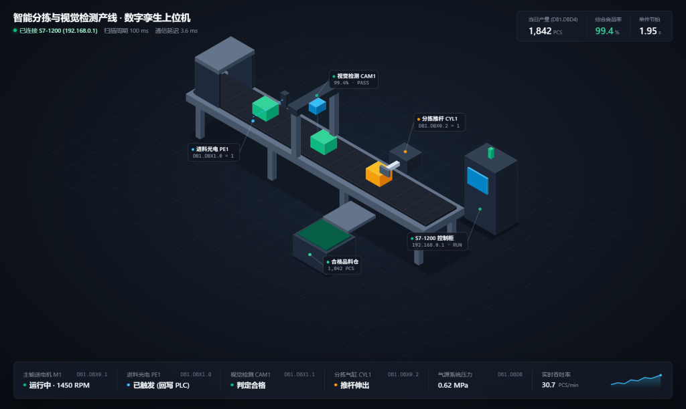
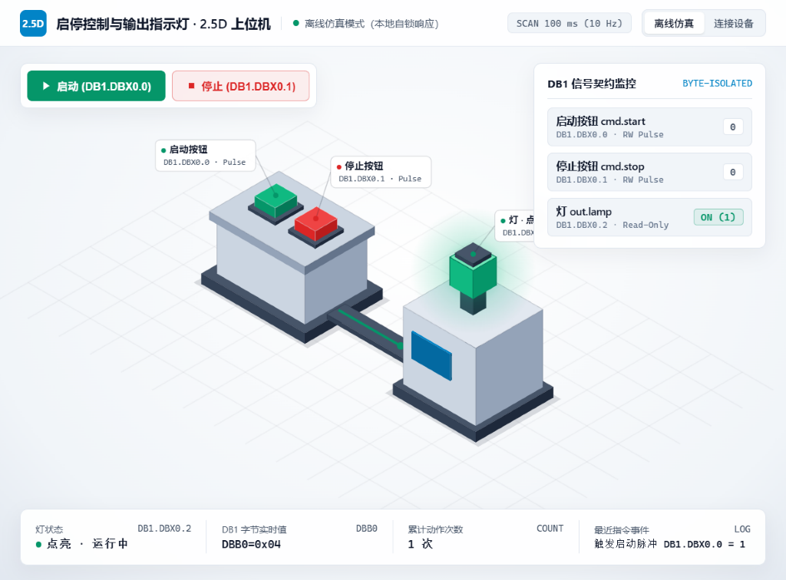
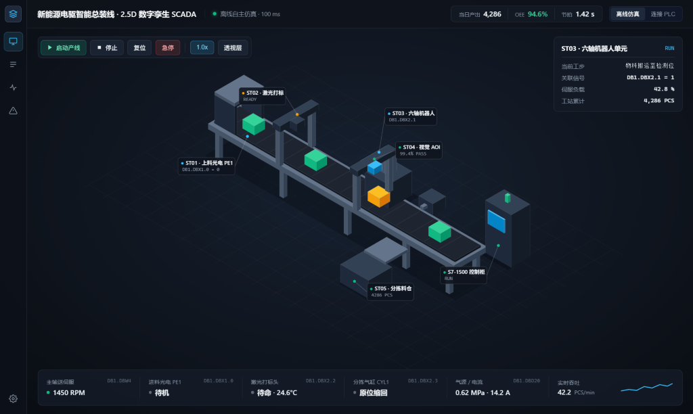
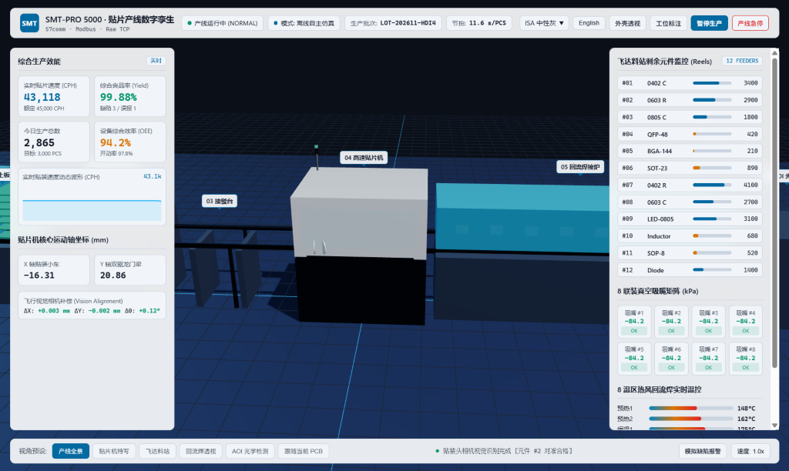
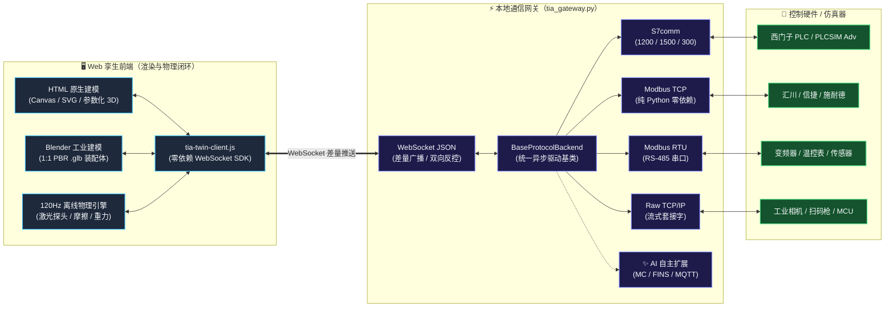

<div align="center">

# 🏭 Industrial Twin Skill

**给 AI 一份 PLC 点表，自动生成能读能写、双击即开的工业 Web 3D/2D 上位机与数字孪生**

**简体中文** · [English](README_en.md)

<p align="center">
  <a href="LICENSE"></a>
  <a href="SKILL.md"></a>
  
  
  
  
</p>

<p align="center">
  <a href="#-实机闭环演示">实机演示</a> •
  <a href="#-ai-skill-极速生成">AI 一键生成</a> •
  <a href="#-为什么做这个项目">核心优势</a> •
  <a href="#-统一系统架构">系统架构</a> •
  <a href="#-双建模流派与多协议矩阵">建模与协议</a> •
  <a href="#-快速开始与绿色交付">快速开始</a> •
  <a href="#-参考文档与目录结构">文档与结构</a>
</p>

</div>

---

## 🎬 实机闭环演示

> [!TIP]
> **不是“自己转圈的假动画”**——前端严格遵循工业 I/O 契约：PLC 输出 `1` 则动、`0` 则停；支持**网页/手机反向写入 PLC**，且 3D 物料触发虚拟光电后自动向 PLC 回写传感器信号。

<div align="center">
  
  <br/>
  <sub>▲ 2.5D 等轴测数字孪生与实时 PLC 数据上位机（遵循 ISA-101 工业 HMI 视觉规范）</sub>
</div>

### 📦 行业落地示例矩阵（见 [`examples/`](examples)）

<table>
  <tr>
    <td width="33%" align="center">
      <a href="examples/plc-lamp-25d">
        
      </a>
      <br/>
      <b><a href="examples/plc-lamp-25d">启停控制与输出小灯 (2.5D 入门闭环)</a></b>
      <br/>
      <sub>2.5D 交互按钮 · 原子单比特写入 · 串口识别</sub>
    </td>
    <td width="33%" align="center">
      <a href="examples/smart-factory-scada">
        
      </a>
      <br/>
      <b><a href="examples/smart-factory-scada">新能源电驱总装线 (2.5D 多视图)</a></b>
      <br/>
      <sub>6 工位闭环 · 多协议设备管理 · 实时波形</sub>
    </td>
    <td width="33%" align="center">
      <a href="examples/smt-pick-and-place">
        
      </a>
      <br/>
      <b><a href="examples/smt-pick-and-place">SMT 贴片产线 (组态与数据)</a></b>
      <br/>
      <sub>7 工位工艺组态 · 飞达与 8 温区 · 多协议</sub>
    </td>
  </tr>
</table>

---

## 🤖 AI Skill 一键安装与使用

本仓库内置标准化的 **[`SKILL.md`](SKILL.md)**，兼容 Antigravity / Cursor / Claude Code / Qoder：

- **方式 1（Windows 最简单 · 双击即装）**：下载或克隆本仓库后，直接双击根目录的 **[`install.bat`](install.bat)**，自动同步安装到 Antigravity、`.agents/skills` 与 Claude Code 全局技能目录（macOS/Linux 运行 `./install.sh`）。
- **方式 2（一行命令直接拉取到全局技能目录）**：
  ```bash
  git clone https://github.com/xukuncai-hub/industrial-twin-skill.git ~/.gemini/config/skills/industrial-twin-skill
  ```

安装后新开对话，**直接把你现有的 PLC 变量表 / Modbus 寄存器表 / 博途截图甩给 AI**（AI 会原样按你的地址生成上位机，不改你原有 PLC 程序；如果是从零新建测试工程，也会一并附带博途 SCL）：

```text
请严格遵循 SKILL.md 规范，按我下面这份现有变量表生成工业上位机（不要改我的地址）：
- 设备类型：西门子 S7-1200 (192.168.0.10) / 或 Modbus TCP (192.168.0.21:502)
- 变量表：
  1. DB10.DBX0.0  系统启动（读写）
  2. Q0.0         传送带运行反馈（只读）
  3. DB10.DBX1.0  光电传感器 PE1（网页触发后回写给 PLC）
  4. DB10.DBD4    实时产量计数（只读）
```

> [!IMPORTANT]
> 交付给客户或答辩演示时，**对方电脑无需安装 Python / Node.js，也无需敲一行命令行**——工程目录自带便携绿色运行时，双击桌面图标即可离线运行。

---

## 🌟 为什么做这个项目？

| 维度 | ❌ 传统 Web 3D 页面 / 玩具大屏 | ✅ 本方案工业级数字孪生体系 |
| :--- | :--- | :--- |
| **控制机理** | 前端写死循环动画，与真实设备脱节 | **动静分离、真物理闭环**：PLC 信号驱动动作，射线/碰撞检测反向回写虚拟传感器 |
| **建模效率** | AI 手搓粗糙积木块，或 CAD 导出几百万面卡死浏览器 | **双轨并行**：`HTML 原生代码秒开` 或 `Blender 工业级 PBR (.glb)` 全面替代重型 CAD |
| **通信协议** | 绑死单一厂商，或依赖笨重的商业 OPC UA 套件 | **原生多协议解耦**：S7comm / Modbus TCP / RTU (RS-485) / Raw TCP，支持 AI 10 分钟扩展新协议 |
| **双向联动** | 只读展示，改个点表前后端全部返工 | **五合一统一契约**：一份 `twin.manifest.json` 自动生成博途 DB 块、闭环 SCL、网关映射与前端绑定 |
| **现场交付** | 客户电脑装环境、配依赖、Win11 报毒拦截 | **极简绿色交付**：内置便携 Python 运行时，纯 ASCII 脚本兼容 Win11 24H2，双击静默常驻 |

---

## 📐 统一系统架构



---

## 🎨 双建模流派与多协议矩阵

### 1. 双建模流派：告别纠结“2D 还是 3D”

| 流派模式 | 启动参数 | 适用场景 | 核心优势 |
| :--- | :--- | :--- | :--- |
| **HTML 原生建模** | `--mode html` | 快速原型、教学调试、毕设极速出图 | 零外部美术资产，纯代码秒级生成，工程体积 `< 2MB` |
| **Blender 工业建模** | `--mode blender` | 产线汇报、高保真展台、替代 NX/SolidWorks | 配合 `CAD Sketcher` 约束，导出 10~30 万面轻量 PBR `.glb` |

配套提供零依赖模型自检脚本，一键解析 `.glb` 节点树并自动生成 `twin.manifest.json` 绑定关系（建模规范详见 [`references/blender-industrial-modeling.md`](references/blender-industrial-modeling.md)）：

```bash
python scripts/inspect_glb.py assets/models/my_line.glb
```

### 2. 原生内置工业协议（前后端彻底解耦）

| 协议驱动 | 配置标识 | 支持范围与技术特性 |
| :--- | :--- | :--- |
| **西门子 S7comm** | `s7` | 支持 S7-1200 / 1500 / 300 / 400 及 **PLCSIM Advanced**；穿透非优化 `DB`、`%I`、`%Q`、`%M`、16 位模拟量（`IW/QW/MW`）与 32 位浮点（`MD/DBD`）；底层按 `(area, db)` 自动合并连续块，实现 **10~30Hz** 高频刷新 |
| **Modbus TCP** | `modbus-tcp` | 纯 Python 异步实现、**零第三方依赖**，原生支持 `0x / 1x / 3x / 4x` 线圈与寄存器 |
| **Modbus RTU** | `modbus-rtu` | 支持 RS-485 串口参数配置与 CRC16 帧收发，直连变频器与现场仪表 |
| **三菱 MC** | `mc` | 纯 Python 原生支持 QnA 3E Binary (端口 `5000`)，直连 FX5U / Q / iQ-R (`D/M/X/Y`) |
| **欧姆龙 FINS** | `fins` | 纯 Python 原生支持 FINS/TCP (端口 `9600`)，直连 CP1H / CJ2M / NX1P (`DM/CIO/WR/HR`) |
| **MQTT 3.1.1** | `mqtt` | 零第三方依赖轻量客户端 (端口 `1883`)，Tag 地址直接映射 Topic |
| **Raw TCP/IP** | `tcp-raw` | 支持二进制流与定界符切包，直连工业扫码枪、视觉相机及 ESP32/STM32 等自研板卡 |
| **AI 自主扩展** | 自定义 | 遵循 [`references/protocol-extension-guide.md`](references/protocol-extension-guide.md) 继承 `BaseProtocolBackend`，即可扩展 Beckhoff ADS / EtherNet/IP 等私有协议 |

---

## ⚡ 快速开始与绿色交付

### 开发者 / AI Agent：一键生成工程脚手架

```bash
# 克隆仓库
git clone https://github.com/xukuncai-hub/industrial-twin-skill.git
cd industrial-twin-skill

# 模式 A：Blender 高保真 3D 工程（推荐现场交付）
python scripts/make_project.py --out ./my-sorting-line --mode blender

# 模式 B：HTML 原生轻量工程（推荐极速原型）
python scripts/make_project.py --out ./my-sorting-line --mode html
```

### 最终用户：3 种免终端启动方式（零 Python 环境要求）

| 启动方式 | 适用场景 | 操作步骤 |
| :--- | :--- | :--- |
| **桌面图标一键直达** | 日常使用（最推荐） | 首次双击 `make_shortcut.bat` 生成桌面图标，后续双击秒开 |
| **目录双击调试** | 本地开发与联调 | 双击 `start.bat`，自动调用便携运行时启动网关并弹出浏览器 |
| **后台静默常驻** | 车间平板 / 手机无线访问 | 双击 `start_silent.bat` 无黑窗驻留后台，局域网浏览器直连；双击 `stop.bat` 退出 |

> [!NOTE]
> **西门子 TIA Portal 联调 3 步必检：**
> 1. CPU 属性 → 防护与安全 → 勾选 **允许来自远程对象的 PUT/GET 通信访问**
> 2. 外部源文件导入脚本生成的 `TwinIO.scl`（已自带 `{ S7_Optimized_Access := 'FALSE' }`）与 `TwinDemoLogic.scl`
> 3. 在 `OB1` 中调用 `"TwinDemoLogic"();` 并下载到 PLC 或 PLCSIM Advanced，即可 1 分钟跑通闭环。

---

## 📚 参考文档与目录结构

| 规范文档 | 说明 |
| :--- | :--- |
| [`references/contract.md`](references/contract.md) | `tia-web-twin/1` WebSocket 通信协议与 I/O 契约规范 |
| [`references/ui-beautification-guide.md`](references/ui-beautification-guide.md) | 工业上位机 HTML 美化子技能（融合 `frontend-design` / `ui-ux-pro-max` / `impeccable` + ISA-101 规范） |
| [`references/blender-industrial-modeling.md`](references/blender-industrial-modeling.md) | Blender 工业级机电建模六大铁律与 `.glb` 导出规范 |
| [`references/cad-import-guide.md`](references/cad-import-guide.md) | 外部 3D CAD 资产轻量化导入与节点绑定指南 |
| [`references/protocol-extension-guide.md`](references/protocol-extension-guide.md) | `BaseProtocolBackend` 多协议扩展开发指南 |
| [`references/tia-setup-guide.md`](references/tia-setup-guide.md) | 实体 PLC 与 PLCSIM Advanced 博途联调指南 |
| [`references/deployment.md`](references/deployment.md) | 绿色便携打包与 Windows 11 24H2 部署避坑说明 |

<details>
<summary><b>👉 点击展开：“五合一”工业契约体系说明</b></summary>

1. **`twin.manifest.json`**：跨平台唯一真相源，集中声明变量 ID、寻址地址（S7 / Modbus / TCP）、数据类型与读写权限。
2. **`TwinIO.scl`**：由 `generate_scl.py` 自动生成的博途非优化 DB 块源码，一键导入生成 `DB1`。
3. **`TwinDemoLogic.scl`**：同步生成的配套闭环控制逻辑（含启停自锁、PE1 光电推料、计数复位），1 分钟验证活体闭环。
4. **`tia-twin-client.js`**：零依赖前端 SDK，内置心跳保活、RTT 延迟监控、离线 Mock 切换与 `50ms/100ms` 节拍切换。
5. **`tia_gateway.py`**：多协议差量广播网关，支持运行时热切换目标设备与协议驱动。

</details>

<details>
<summary><b>👉 点击展开：完整仓库目录结构</b></summary>

```text
industrial-twin-skill/
├── SKILL.md                          # AI Agent Skill 核心规范、工程红线与标准 SOP
├── README.md / README_en.md          # 中英文项目文档
├── examples/
│   ├── README.md                     # 行业数字孪生示例索引
│   ├── smart-factory-scada/          # 新能源电驱智能总装线 (大型多视图 2.5D SCADA)
│   └── smt-pick-and-place/           # SMT 高速贴片机完整落地示例 (3D / 上位机 / Blender / SCL / 网关)
├── references/                       # 建模、CAD 导入、协议扩展、WS 契约、博途与部署指南
├── scripts/
│   ├── make_project.py               # 一键脚手架（装配工程 + 便携运行时 + 桌面快捷方式生成）
│   ├── inspect_glb.py                # 零依赖 .glb 节点解析与 bindings 自动生成
│   ├── tia_gateway.py                # 多协议高性能通信网关 (S7 / Modbus / Raw TCP)
│   ├── generate_scl.py               # 从 manifest 一键生成博途 DB 与控制逻辑 SCL
│   ├── validate_manifest.py          # 信号清单语法与地址对齐校验
│   ├── run_twin.py                   # 服务管理与浏览器自动唤起
│   ├── desktop_app.py                # 独立桌面客户端入口
│   ├── start.bat / start_silent.bat / stop.bat / make_shortcut.bat
│   ├── start_twin.bat / start_twin.sh
│   ├── build_exe.bat / tia_twin.spec # PyInstaller 独立 EXE 打包脚本
│   └── requirements.txt              # Python 依赖清单
└── assets/
    ├── runtime/                      # 内置免安装 Python 3.11 运行时 (portable-runtime.zip) 与前端 SDK
    ├── template/                     # HTML 原生纯代码建模模板
    ├── three-demo/                   # Blender 工业建模 WebGL 模板（含离线 Three.js & GLTFLoader）
    └── tia/                          # TwinIO.scl 与 TwinDemoLogic.scl 模板
```

</details>

<details>
<summary><b>👉 点击展开：工业通讯与 Windows 11 24H2 避坑要点</b></summary>

- **废弃 VBScript**：全面淘汰 `.vbs` 脚本，改用纯 7-bit ASCII `.bat` 与原生 PowerShell 实现无黑窗静默运行。
- **避免单文件 EXE 临时目录拦截**：Win11 24H2 严格拦截单文件 EXE 动态解压至 `%TEMP%`，日常推荐原生批处理与桌面快捷方式。
- **避免跨盘符虚拟环境冲突**：启动器原生优先调用自带绿色环境（`./runtime/`），免去配置 Path 与管理员权限的麻烦。
- **严禁向物理输入区（`%I`）直写**：PLC 扫描周期起始阶段会刷新过程映像输入（PII），强写 `%I` 会在微秒内被悬空端子置 `0`；虚拟传感器必须写入非优化数据块（`TwinIO` DB）或 Modbus 寄存器供 PLC 读取。
- **读写字节严格隔离（Byte Isolation）**：底层位写入本质是字节级“读-改-写”，同一字节内严禁混排只读位（`r`）与写入位（`w`），防止上位机回写覆盖 PLC 状态。
- **规避浏览器 ES 模块本地强缓存**：`run_twin.py` 服务端强制注入 `Cache-Control: no-cache, no-store`，前端引入附加时间戳，避免改完代码浏览器仍读旧缓存。

</details>

---

## 🤝 交流与支持

如果这个项目帮你省掉了画组态的时间、或者让你的毕设/项目顺畅跑通了闭环，欢迎点一个免费的 **⭐ Star**！  
遇到协议对接问题或想扩展新 PLC 驱动，欢迎直接提交 [Issue](https://github.com/xukuncai-hub/industrial-twin-skill/issues) 或 PR。

<div align="center">
  <sub>Released under the <a href="LICENSE">MIT License</a>.</sub>
</div>
