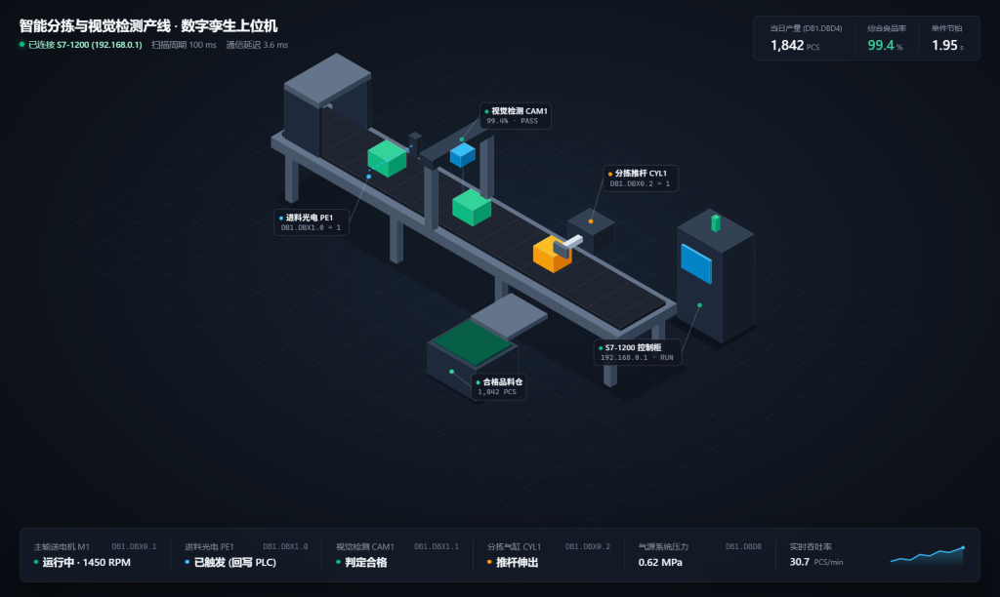
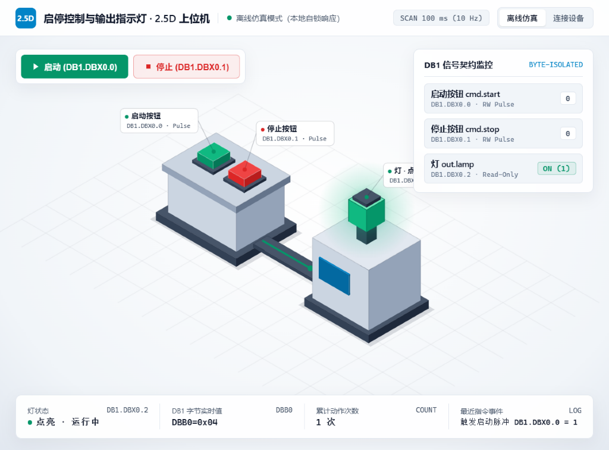
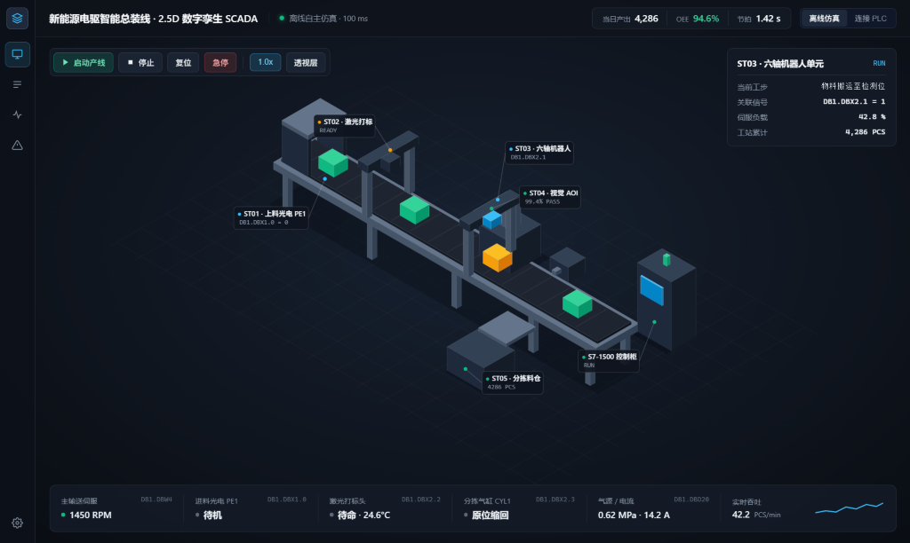
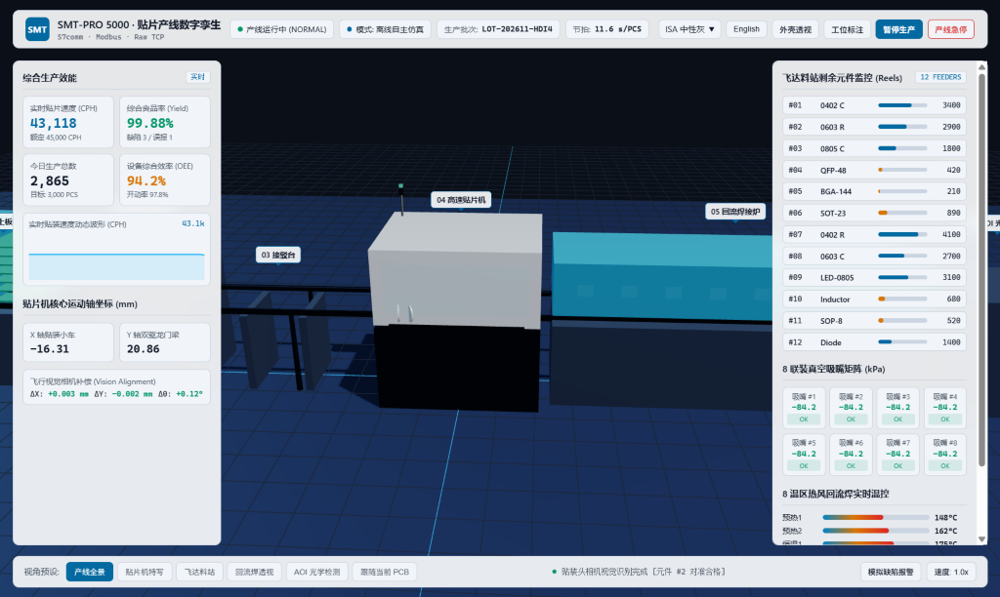
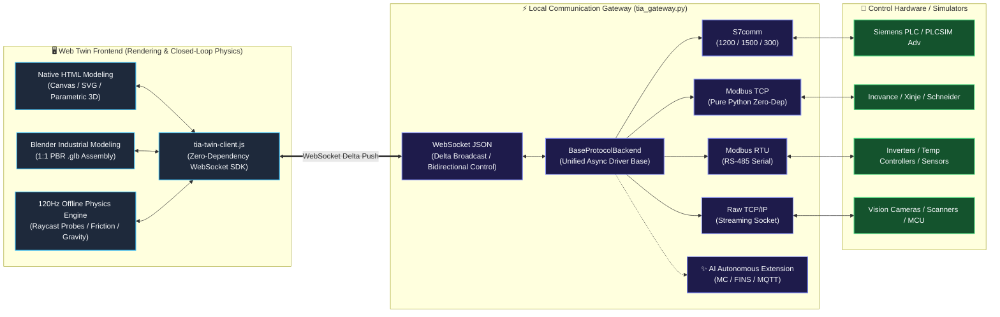

<div align="center">

# 🏭 Industrial Twin Skill

**Give AI a PLC tag table — automatically generate a bidirectional, double-click-ready Industrial Web 3D/2D SCADA & Digital Twin**

[简体中文](README.md) · **English**

<p align="center">
  <a href="LICENSE"></a>
  <a href="SKILL.md"></a>
  
  
  
  
</p>

<p align="center">
  <a href="#-live-closed-loop-showcase">Showcase</a> •
  <a href="#-ai-skill-quick-generation">AI Skill</a> •
  <a href="#-why-this-project">Core Breakthroughs</a> •
  <a href="#-system-architecture">Architecture</a> •
  <a href="#-dual-modeling-paradigms--protocol-matrix">Modeling & Protocols</a> •
  <a href="#-quick-start--portable-delivery">Quick Start</a> •
  <a href="#-references--repository-structure">Docs & Structure</a>
</p>

</div>

---

## 🎬 Live Closed-Loop Showcase

> [!TIP]
> **Not a "fake looping animation"** — the frontend strictly follows the industrial I/O contract: PLC output `1` moves, `0` stops. Supports **bidirectional write-back from Web/mobile to PLC**, and virtual photoelectric sensors automatically write back to the PLC when 3D workpieces trigger raycast probes.

<div align="center">
  
  <br/>
  <sub>▲ 2.5D Isometric Digital Twin & Real-Time PLC Telemetry SCADA (ISA-101 Industrial HMI Design)</sub>
</div>

### 📦 Industry Showcases (See [`examples/`](examples))

<table>
  <tr>
    <td width="33%" align="center">
      <a href="examples/plc-lamp-25d">
        
      </a>
      <br/>
      <b><a href="examples/plc-lamp-25d">Start/Stop &amp; Lamp (2.5D Starter)</a></b>
      <br/>
      <sub>Interactive 2.5D · Atomic Bit Write · COM Scan</sub>
    </td>
    <td width="33%" align="center">
      <a href="examples/smart-factory-scada">
        
      </a>
      <br/>
      <b><a href="examples/smart-factory-scada">EV Drive Line (2.5D Multi-View)</a></b>
      <br/>
      <sub>6-Station Twin · Device Manager · Live Trends</sub>
    </td>
    <td width="33%" align="center">
      <a href="examples/smt-pick-and-place">
        
      </a>
      <br/>
      <b><a href="examples/smt-pick-and-place">SMT Line (Mimic &amp; Data)</a></b>
      <br/>
      <sub>7-Station Mimic · Feeders &amp; Oven · Multi-Proto</sub>
    </td>
  </tr>
</table>

---

## 🤖 AI Skill 1-Click Install & Usage

This repository includes a standardized **[`SKILL.md`](SKILL.md)** compatible with Antigravity, Cursor, Claude Code, and Qoder:

- **Option 1 (Easiest · 1-Click Installer)**: Clone or download this repo and double-click **[`install.bat`](install.bat)** on Windows (or run `./install.sh` on macOS/Linux) to install into Antigravity, `.agents/skills`, and Claude Code global skill directories automatically.
- **Option 2 (1-Command Direct Clone)**:
  ```bash
  git clone https://github.com/xukuncai-hub/industrial-twin-skill.git ~/.gemini/config/skills/industrial-twin-skill
  ```

Start a new conversation and **paste your existing PLC tag table, Modbus register list, or TIA Portal screenshot** (AI maps your exact addresses without altering your existing PLC program; if starting from scratch, it also generates TIA SCL files):

```text
Follow SKILL.md strictly and generate an industrial SCADA / Digital Twin for my existing tag table (keep my addresses unchanged):
- Device: Siemens S7-1200 (192.168.0.10) or Modbus TCP (192.168.0.21:502)
- Tag Table:
  1. DB10.DBX0.0  System Start (RW)
  2. Q0.0         Conveyor Running (R)
  3. DB10.DBX1.0  Photoelectric Sensor PE1 (written back to PLC)
  4. DB10.DBD4    Live Production Count (R)
```

> [!IMPORTANT]
> When delivering to customers or shopfloor PCs, **no Python or Node.js installation and zero CLI commands are required** — generated projects bundle a portable Python runtime for 1-click desktop launch.

---

## 🌟 Why This Project?

| Dimension | ❌ Traditional Web 3D / Toy Dashboards | ✅ Our Industrial Digital Twin Standard |
| :--- | :--- | :--- |
| **Control Kinematics** | Hardcoded looping animations disconnected from hardware | **Static/Dynamic separation & closed-loop physics**: PLC signals drive actuators; raycast/collision sensors write back to PLC |
| **Modeling Pipeline** | Blocky primitive meshes or multi-million-poly CAD exports | **Dual Paradigm**: Instant `Native HTML` code or lightweight `Blender PBR (.glb)` replacing heavy CAD |
| **Industrial Comms** | Locked to one vendor or bloated commercial OPC UA suites | **Decoupled Multi-Protocol**: S7comm / Modbus TCP / RTU (RS-485) / Raw TCP, extensible in 10 mins by AI |
| **Bidirectional Sync** | Read-only display; tag changes require full rewrite | **5-in-1 Unified Contract**: One `twin.manifest.json` generates TIA DB blocks, SCL logic, gateway mapping & UI bindings |
| **Shopfloor Delivery** | Complex env setup, dependency hell, Win11 Defender blocks | **Zero-Setup Portable**: Bundled portable Python, pure 7-bit ASCII scripts, Win11 24H2 certified |

---

## 🏗️ System Architecture



---

## 🎨 Dual Modeling Paradigms & Protocol Matrix

### 1. Dual Modeling Paradigms: Native HTML vs. Blender CAD

| Paradigm | CLI Flag | Best For | Key Advantage |
| :--- | :--- | :--- | :--- |
| **Native HTML Modeling** | `--mode html` | Rapid prototyping, training, instant single-file demos | Zero external assets, pure code generation, `< 2MB` footprint |
| **Blender Industrial Modeling** | `--mode blender` | Shopfloor delivery, digital showrooms, replacing NX/SolidWorks | Parametric `CAD Sketcher` constraints, lightweight 100k–300k poly PBR `.glb` |

Includes a zero-dependency `.glb` node inspector that parses hierarchy trees and auto-generates `twin.manifest.json` bindings (see [`references/blender-industrial-modeling.md`](references/blender-industrial-modeling.md)):

```bash
python scripts/inspect_glb.py assets/models/my_line.glb
```

### 2. Built-in Industrial Protocols (Fully Decoupled)

| Driver | Config ID | Supported Hardware & Features |
| :--- | :--- | :--- |
| **Siemens S7comm** | `s7` | S7-1200 / 1500 / 300 / 400 & **PLCSIM Advanced**; penetrates non-optimized `DB`, `%I`, `%Q`, `%M`, 16-bit analog (`IW/QW/MW`), and 32-bit float (`MD/DBD`); merges contiguous `(area, db)` ranges for **10–30Hz** refresh |
| **Modbus TCP** | `modbus-tcp` | Pure async Python with **zero external dependencies**, supporting `0x / 1x / 3x / 4x` coils and registers |
| **Modbus RTU** | `modbus-rtu` | RS-485 serial fieldbus with native CRC16 framing for inverters and meters |
| **Mitsubishi MC** | `mc` | Pure async Python QnA 3E Binary (Port `5000`) for FX5U / Q / iQ-R (`D/M/X/Y`) |
| **Omron FINS** | `fins` | Pure async Python FINS/TCP (Port `9600`) for CP1H / CJ2M / NX1P (`DM/CIO/WR/HR`) |
| **MQTT 3.1.1** | `mqtt` | Zero-dependency lightweight client (Port `1883`), mapping Tag addresses directly to Topics |
| **Raw TCP/IP** | `tcp-raw` | Binary streams & delimiter framing for barcode scanners, vision cameras, and ESP32/STM32 boards |
| **AI Extension** | Custom | Subclass `BaseProtocolBackend` per [`references/protocol-extension-guide.md`](references/protocol-extension-guide.md) to add Beckhoff ADS, EtherNet/IP, or custom protocols |

---

## ⚡ Quick Start & Portable Delivery

### Developer / AI Agent: 1-Click Project Scaffolding

```bash
# Clone repository
git clone https://github.com/xukuncai-hub/industrial-twin-skill.git
cd industrial-twin-skill

# Mode A: Blender high-fidelity 3D project (Recommended for delivery)
python scripts/make_project.py --out ./my-sorting-line --mode blender

# Mode B: Native HTML lightweight project (Recommended for rapid prototyping)
python scripts/make_project.py --out ./my-sorting-line --mode html
```

### End-User: 3 Zero-CLI Launch Options (No Python Required)

| Launch Mode | Best For | Action |
| :--- | :--- | :--- |
| **Desktop Shortcut** | Daily operation (**Recommended**) | Double-click `make_shortcut.bat` once to create a desktop icon |
| **Direct Batch Launch** | Local debugging & commissioning | Double-click `start.bat` to launch gateway via portable runtime and open browser |
| **Silent Background Service** | Workshop tablets / mobile LAN access | Double-click `start_silent.bat` (no console window); stop anytime with `stop.bat` |

> [!NOTE]
> **Siemens TIA Portal 3-Step Checklist:**
> 1. CPU Properties → Protection & Security → Enable **Permit access with PUT/GET communication from remote partner**
> 2. Import generated `TwinIO.scl` (with `{ S7_Optimized_Access := 'FALSE' }`) and `TwinDemoLogic.scl` as External Source Files
> 3. Call `"TwinDemoLogic"();` in `OB1` and download to PLC or PLCSIM Advanced.

---

## 📚 References & Repository Structure

| Reference Guide | Description |
| :--- | :--- |
| [`references/contract.md`](references/contract.md) | `tia-web-twin/1` WebSocket protocol & I/O manifest specification |
| [`references/ui-beautification-guide.md`](references/ui-beautification-guide.md) | Industrial SCADA HTML beautification sub-skill (fusing `frontend-design` / `ui-ux-pro-max` / `impeccable` + ISA-101) |
| [`references/blender-industrial-modeling.md`](references/blender-industrial-modeling.md) | Blender industrial modeling SOP & 6 hard rules for `.glb` export |
| [`references/cad-import-guide.md`](references/cad-import-guide.md) | External 3D CAD asset import, decimation & binding guide |
| [`references/protocol-extension-guide.md`](references/protocol-extension-guide.md) | `BaseProtocolBackend` multi-protocol extension guide |
| [`references/tia-setup-guide.md`](references/tia-setup-guide.md) | Physical PLC & PLCSIM Advanced TIA Portal setup guide |
| [`references/deployment.md`](references/deployment.md) | Portable packaging & Windows 11 24H2 deployment notes |

<details>
<summary><b>👉 Expand: "5-in-1" Industrial I/O Contract Suite</b></summary>

1. **`twin.manifest.json`**: Single source of truth defining tag IDs, PLC addresses (S7 / Modbus / TCP), data types, and access modes.
2. **`TwinIO.scl`**: Auto-generated TIA Portal non-optimized DB source file via `generate_scl.py`.
3. **`TwinDemoLogic.scl`**: Auto-generated closed-loop PLC logic (start/stop interlock, PE1 trigger, counter reset).
4. **`tia-twin-client.js`**: Zero-dependency frontend SDK with heartbeat, RTT latency monitor, offline mock fallback, and `50ms/100ms` polling switch.
5. **`tia_gateway.py`**: Multi-protocol delta-broadcasting gateway with runtime device & protocol switching.

</details>

<details>
<summary><b>👉 Expand: Full Repository Structure</b></summary>

```text
industrial-twin-skill/
├── SKILL.md                          # AI Agent Skill specification, hard rules & SOP
├── README.md / README_en.md          # Chinese & English documentation
├── examples/
│   ├── README.md                     # Industrial Digital Twin Examples Index
│   ├── smart-factory-scada/          # EV Drive Assembly Line (Large-Scale Multi-View 2.5D SCADA)
│   └── smt-pick-and-place/           # SMT Pick & Place Line Showcase (3D / SCADA / Blender / SCL / Gateway)
├── references/                       # Modeling, CAD import, protocol extension, WS contract & TIA guides
├── scripts/
│   ├── make_project.py               # 1-click project scaffolder (template + portable runtime + shortcuts)
│   ├── inspect_glb.py                # Zero-dependency .glb node inspector & binding generator
│   ├── tia_gateway.py                # Multi-protocol gateway (S7 / Modbus / Raw TCP)
│   ├── generate_scl.py               # TIA Portal DB & SCL source code generator
│   ├── validate_manifest.py          # Signal manifest syntax & memory alignment validator
│   ├── run_twin.py                   # Service supervisor & browser launcher
│   ├── desktop_app.py                # Standalone desktop client entry
│   ├── start.bat / start_silent.bat / stop.bat / make_shortcut.bat
│   ├── start_twin.bat / start_twin.sh
│   ├── build_exe.bat / tia_twin.spec # PyInstaller standalone EXE packaging
│   └── requirements.txt              # Python dependencies
└── assets/
    ├── runtime/                      # Portable Python 3.11 runtime (portable-runtime.zip) & frontend SDK
    ├── template/                     # Native HTML modeling template
    ├── three-demo/                   # Blender WebGL template (offline Three.js & GLTFLoader)
    └── tia/                          # TwinIO.scl & TwinDemoLogic.scl templates
```

</details>

<details>
<summary><b>👉 Expand: Industrial Comms & Windows 11 24H2 Pitfall Prevention</b></summary>

- **Deprecated VBScript**: Replaced `.vbs` with pure 7-bit ASCII `.bat` and native PowerShell for silent background launch.
- **Avoid Single-File `%TEMP%` EXE Blocking**: Win11 24H2 restricts single-file EXE temp extraction; portable folders and desktop shortcuts are recommended.
- **Prevent Virtualenv Path Conflicts**: Launchers prioritize `./runtime/` directly, avoiding system PATH or admin permission issues.
- **Never Direct-Write to Physical Inputs (`%I`)**: PLC scan cycles overwrite Process Image Inputs (PII) every cycle; virtual sensors must write to non-optimized DBs (`TwinIO`) or Modbus registers.
- **Strict Byte Isolation**: Bit writes perform byte-level read-modify-write; never mix read-only (`r`) and writable (`w`) bits in the same byte.
- **Bypass Browser ES Module Cache**: `run_twin.py` injects `Cache-Control: no-cache, no-store` headers so frontend edits take effect immediately.

</details>

---

## 🤝 Support & Contributing

If this project saved you time on SCADA configuration or helped your digital twin run smoothly, please give it a **⭐ Star**!  
For protocol questions or new PLC driver contributions, feel free to open an [Issue](https://github.com/xukuncai-hub/industrial-twin-skill/issues) or Pull Request.

<div align="center">
  <sub>Released under the <a href="LICENSE">MIT License</a>.</sub>
</div>
