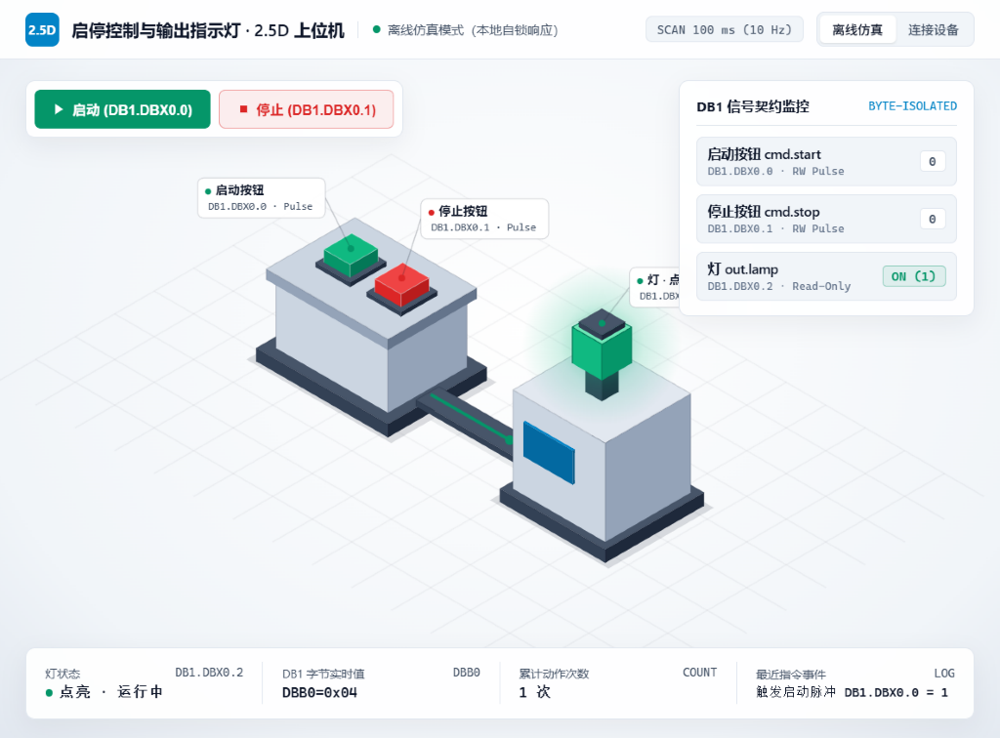

# 💡 启停控制与输出指示灯 · 2.5D 工业上位机示例

本示例位于 `industrial-twin-skill/examples/plc-lamp-25d`，是最简入门级 **2.5D 工业闭环数字孪生**（2 个启停按钮 + 1 个输出小灯），适合 1 分钟快速验证西门子 S7 / PLCSIM Advanced / Modbus / 三菱 MC 实机通信。

  
   
  ▲ 2.5D 交互式启停控制台、信号脉冲总线与输出指示灯（瑞士极简浅色风格）

## 🔌 DB1 信号映射（原样匹配博途变量表）

| 变量 ID | PLC 地址 | 类型 | 读写模式 | 说明 |
| :--- | :--- | :--- | :--- | :--- |
| `cmd.start` | `DB1.DBX0.0` | Bool | RW (`Pulse 200ms`) | 启动按钮（支持点击 2.5D 按钮或左上角按钮） |
| `cmd.stop` | `DB1.DBX0.1` | Bool | RW (`Pulse 200ms`) | 停止按钮（采用 S7 原子单比特写入，不覆盖同字节其他位） |
| `out.lamp` | `DB1.DBX0.2` | Bool | Read-Only | 输出小灯状态（`1`=点亮，`0`=熄灭） |

## 🚀 快速运行

1. **离线体验**：直接双击 [`index.html`](index.html)，点击画布上的绿色/红色 2.5D 按钮即可本地自锁点亮/熄灭小灯。
2. **连接真实 PLC / 仿真器**：双击 [`start.bat`](start.bat) 自动拉起网关并打开网页，点右上角 **“连接设备”** 选择协议预设（支持串口自动识别）即可联调。
