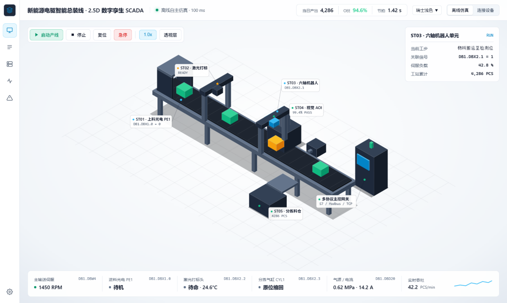

# 🏭 新能源电驱智能总装线 · 大型 2.5D 数字孪生 SCADA

本示例位于 `industrial-twin-skill/examples/smart-factory-scada`，严格遵循 [`references/ui-beautification-guide.md`](../../references/ui-beautification-guide.md)（融合 `frontend-design` / `ui-ux-pro-max` / `impeccable` + ISA-101 工业 HMI 规范）构建，适用于多工位、多视图的大型工业上位机项目。

  
   
  ▲ 瑞士极简浅色（默认）+ 4 套工业主题切换 · 6 工位 2.5D 数字孪生 · 多协议设备与数据点位管理

## ✨ 核心特性

- **四视图大型 SCADA 架构**：左侧极简图标导航栏支持一键切换：
  1. **2.5D 数字孪生监控**：6 工位（`ST01` 上料 → `ST02` 激光打标 → `ST03` 六轴机器人 → `ST04` 视觉 AOI → `ST05` 气动分拣 → `ST06` 控制柜）实时运动学仿真，支持启动/停止/复位/急停、1x/2x 倍速与透视层切换。
  2. **I/O 点表实时监视器**：20 个跨协议信号（`S7` / `Modbus TCP` / `Modbus RTU` / `Raw TCP`）实时刷新与关键字检索。
  3. **设备接入与数据点位管理**：专门的多协议设备与数据管理界面，支持在线启停/新增 `S7comm`、`Modbus TCP`、`Modbus RTU (RS-485)`、`Raw TCP/IP` 设备通道，动态增删点位映射并一键导出 `twin.manifest.json`。
  4. **多通道实时波形与 OEE**：Canvas 实时绘制主驱动母线电流波形及可用率/性能/良品率拆解。
  5. **联锁与事件审计日志**：带毫秒时间戳的指令与安全急停记录。
- **零环境依赖**：直接双击 [`index.html`](index.html) 即可离线运行；也可配合 `scripts/tia_gateway.py` 与生成的 [`TwinIO.scl`](TwinIO.scl) / [`TwinDemoLogic.scl`](TwinDemoLogic.scl) 连接真实 S7-1500/1200 或 PLCSIM Advanced。
