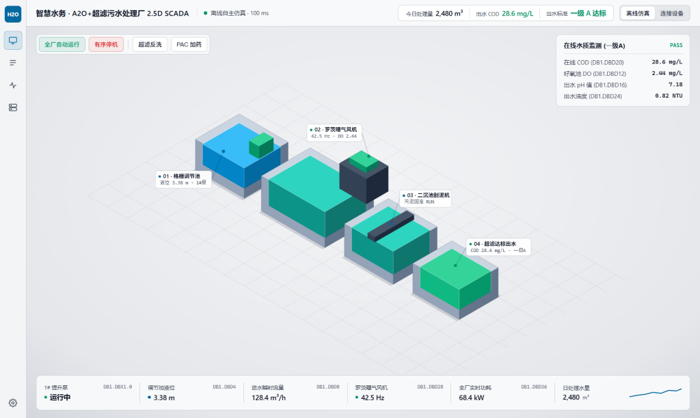

# 💧 智慧水务与污水处理 SCADA · 2.5D 工艺监控系统

本示例位于 `industrial-twin-skill/examples/water-treatment-scada`，采用 **ISA-101 标准中性灰（`isa-gray`）** 风格构建，面向环保水处理、市政泵站、毕业设计与工控接单定制场景。

  
   
  ▲ A2O + 超滤污水处理 2.5D 工艺流程、在线水质指标与多协议设备监控界面

## ✨ 核心亮点

- **四视图大型水务 SCADA**：
  1. **2.5D 工艺流程监控**：格栅调节池 → A2O 生化反应池（罗茨曝气）→ 二沉池刮泥 → 超滤达标出水，含实时液位、水泵/风机启停、反洗/加药控制与在线水质（COD / DO / pH / 浊度）。
  2. **全厂 I/O 信号监视表**：18 个跨协议点位（`PLC-01` S7、`VFD-01` Modbus TCP、`WQ-01` Modbus RTU 水质仪、`IOT-01` MQTT）。
  3. **水质趋势与能耗分析**：出水 COD 实时波形与吨水电耗指标（`0.53 kWh/m³`）。
  4. **多协议设备与点位管理**：支持 `S7comm` / `三菱 MC` / `欧姆龙 FINS` / `Modbus TCP` / `Modbus RTU (含 COM 口自动识别)` / `MQTT` 及导出 `twin.manifest.json`。
- **开箱即用**：双击 [`index.html`](index.html) 即可离线演示；双击 [`start.bat`](start.bat) 自动拉起网关连接真实 PLC 与水质仪表。
